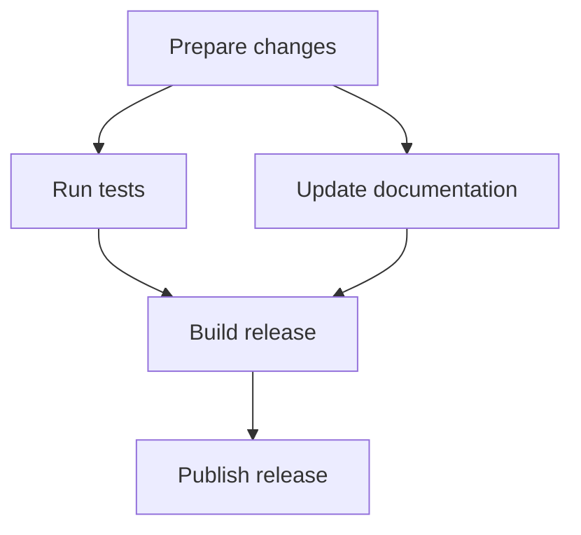

# Formatting details

- [Alerts](#alerts)
- [Diagrams](#diagrams)
- [Math](#math)
- [Examples](#examples)
- [Edit without changing scope](#edit-without-changing-scope)
- [Before-and-after tables](#before-and-after-tables)
- [YAML source](#yaml-source)
- [List spacing](#list-spacing)

## Alerts

For GitHub Alerts, put an empty quoted line containing only `>` immediately after the marker.
Put another empty quoted line between body paragraphs.

| Alert | Use |
| --- | --- |
| NOTE | Supporting information |
| TIP | Practical advice |
| IMPORTANT | Essential condition |
| WARNING | Immediate problem |
| CAUTION | Risk or potential loss |

Place Alerts at the top level near the content they qualify and use them selectively.

## Diagrams

Use fenced `mermaid` blocks for graphs and diagrams.
Choose a diagram type that matches dependencies, sequence, state transitions, or data flow.
Express dependencies as a dependency graph, with arrows from a prerequisite to the task that requires it.
State what arrows mean in other diagram types.
For numerical charts, preserve values, axes, and units.
When several prerequisite arrows converge, explain whether all are required or whether they are alternatives.

Keep each graph focused on one relationship.
Use short labels, at most five nodes horizontally, and a vertical layout or separate diagrams when needed.
Quote labels containing Korean text, punctuation, or parentheses.
Keep detailed conditions and the main interpretation outside the diagram.
Provide `accTitle` and `accDescr` where supported.
Use weights, priorities, or cycles only when the underlying relationship supports them.

## Math

Use LaTeX for relationships expressed as equations or symbols outside graphs.
Define variables, units, assumptions, and symbol meanings near the expression.
Match equality, approximation, inclusion, and implication to the strength of the claim.
Use `\text{...}` for Korean text inside math.
Choose math delimiters supported by the destination and keep long explanations outside equations.
Use a code block for source syntax and the destination's math syntax for a rendered equation.

## Examples

### Paragraph breaks

#### Source

```markdown
The cache expires after 60 seconds.

Restart the service to apply the setting.
```

#### Rendered

The cache expires after 60 seconds.

Restart the service to apply the setting.

### List continuations

Item 2 continues in the same paragraph.
Item 3 has a separate paragraph within the same list item.

#### Source

```markdown
1. Open the document
2. Review the draft
   Check the examples in the same pass
3. Run the checks

   Save the results with the draft
4. Publish the update
```

#### Rendered

1. Open the document
2. Review the draft
   Check the examples in the same pass
3. Run the checks

   Save the results with the draft
4. Publish the update

### GitHub Alert

#### Source

```markdown
> [!IMPORTANT]
>
> Use the same input and concurrency.
>
> Measure again if either changes.
```

#### Rendered

> [!IMPORTANT]
>
> Use the same input and concurrency.
>
> Measure again if either changes.

### Dependency graph

In this graph, an arrow points from a prerequisite to the task that requires it.



Tests and documentation can run in parallel after the changes are ready.
The release build requires both results.

### LaTeX notation

These examples use `$...$` for inline math and `$$...$$` for display math.

| Relationship | Expression | Define |
| --- | --- | --- |
| Equality | $a=b$ | Quantities and conditions |
| Approximation | $a\approx b$ | Tolerance or basis |
| Comparison | $a<b$ | Units and comparison conditions |
| Inclusion | $A\subseteq B$ | Membership of each set |
| Implication | $P\Rightarrow Q$ | Assumptions under which it holds |
| Priority | $A\succ B$ | Meaning of the ordering |

## Edit without changing scope

| Draft | Revision |
| --- | --- |
| It is important to note that the cache expires after 60 seconds and refreshes on the next request. | Cache TTL: 60 seconds |
| | Refresh: next request |
| This is for informational purposes only. | Delete |
| I shortened the sentences and reviewed the wording. | Delete |
| The following verification scope describes what to check after changes, not execution results. | Delete |
| Some requests may fail during a restart. | Some requests may fail during a restart |
| LICENSE notice: THE SOFTWARE IS PROVIDED "AS IS", WITHOUT WARRANTY OF ANY KIND. | LICENSE notice: THE SOFTWARE IS PROVIDED "AS IS", WITHOUT WARRANTY OF ANY KIND. |
| This is a major improvement in how errors are handled: the parser now reports the input offset. | Parser errors include the input offset |
| Verify normal playback and segment looping. | - Verify normal playback |
| | - Verify segment looping |

## Before-and-after tables

In before-and-after tables, align each source passage with its revision.
When one source passage becomes several revised statements or list items, put the full source in the first row and leave later source cells empty.
Write `Delete` in the revision cell when removing source text.
Use a phrase or a sentence in a table cell according to what the reader needs.
Keep required notices and exact quoted text unchanged.

## YAML source

Use block lists for YAML sequences except explicit empty sequences.
Use `|-` for literal multiline strings and `>-` for a wrapped logical line when omitting the final line feed preserves the value.
Preserve parsed values and literal or folded semantics, including frontmatter and template strings.

## List spacing

Within a list item, put a continuation of the same paragraph on the next line, indented to the item content.
Insert a blank line before an indented continuation only when it starts a separate paragraph in that item.
By default, do not insert blank lines between list items or continuation lines.
