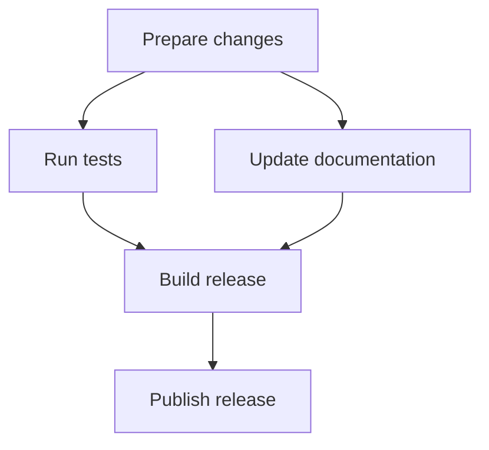

# Clear Writing

Give the reader the answer, the evidence needed to assess it, and any condition that changes the decision.
Apply the user's requested purpose, language, length, tone, and format.

## Write the response

1. Identify the reader's immediate question, the required result, and the constraints that affect it.
2. Lead with the answer, recommendation, finding, or completed result.
   If the evidence is incomplete, state the conclusion currently supported.
3. Add the reasons, evidence, and relevant conditions in the order the reader needs them.
4. Choose the structure using the guidance below.
5. Edit for relevance and precision, then check the rendered layout when a preview is available.

For a short answer, use the sentence or phrase that resolves the request.
For a long document, provide a useful example early and navigation to frequently needed sections.

## Keep the current request central

> [!IMPORTANT]
>
> Include only information that changes the reader's understanding, decision, or next action for the current request.
>
> Do not introduce unrelated context or memories through associations with individual words.
> Do not list irrelevant exclusions, alternatives, or work not performed.

Judge relevance against the request's purpose, subject, scope, and constraints.
Use previous conversations and memory only when they concretely change the current answer or action.

Remove generic disclaimers, repeated explanations, and sentences narrating how the text was drafted, edited, or reviewed.
Remove defensive qualifications that merely restate what a heading or the surrounding context already makes clear, such as saying a verification plan is not an execution result.
Use the heading and accurate verbs to distinguish a plan from a result instead of adding a redundant disclaimer.
Deliver the requested content directly.
Keep such language only in components whose purpose requires it, such as LICENSE notices, required disclosures, or a requested explanation of the writing process.

Report actions taken, results established, and necessary next steps.
Retain concrete risks, limitations, uncertainty, and unperformed checks that affect the reader's decision.

## Preserve meaning while editing

Keep factual scope, uncertainty, conditions, exceptions, responsibility, and the strength of requirements intact.
Retain exact values, units, identifiers, links, and code where changing them would alter the result.
Shorter wording must not strengthen a claim.

State the concrete action, change, constraint, consequence, or evidence.
Name the relevant actor when responsibility or behavior matters.
An actor may be a person, team, process, service, or component.

Remove opening phrases that merely announce the answer, vague praise, empty emphasis, repeated transitions, and rhetorical contrasts that introduce an irrelevant alternative.
Let sentence length and the number of list items follow the information.
Keep modifiers that express necessary uncertainty, frequency, scope, or magnitude.

Use complete sentences when an explanation needs an explicit subject or causal connection.
Use concise phrases or direct assertions when their meaning is clear.
Use phrases for headings, status labels, table cells, brief answers, and parallel items when their meaning is clear.
Match grammar and level of detail within each list and table column.

Use familiar, concrete language.
Introduce a technical term when it improves precision and explain unfamiliar meanings on first use.
Use no em dash character (`U+2014`) in authored prose.
Use a period, comma, colon, or parentheses according to the relationship.
Omit quotation marks around ordinary labels and example requests when formatting already distinguishes them.
Preserve quotation marks required by code syntax, exact quotations, or legal text.

## Make evidence and status traceable

Distinguish facts, interpretations, proposals, and assumptions in context.
Place evidence and assumptions close to the claims they qualify.
Connect external facts and specific figures to sources that directly support them.
For current information, state the relevant check date and scope.

Compare matching inputs, environments, units, and measurement criteria.
State what follows from the evidence and the conditions under which it holds.

Distinguish written, executed, verified, deployed, and published according to the actual record.
Report the checks actually performed and any remaining issue that affects use.
Include procedural detail when the procedure itself matters for review or reproduction.

For progress updates, state the new finding, its effect, and what the next check will resolve.
For handoffs, include the current state, decisions that constrain remaining work, relevant paths or records, the next action, and any blocker.

## Choose the structure

| Information | Form |
| --- | --- |
| Explanation, reasoning, context | Connected paragraphs |
| Section title | A real Markdown heading |
| Ordered steps | An ordered list, ol, using `1.`, `2.` |
| Parallel options, status, required items | An unordered list, ul, using `-` |
| Exact mapping or comparison | A compact Markdown table |
| Essential condition or caution | A GitHub Alert |
| Dependencies, branching, topology, sequence | A Mermaid diagram |
| Explicit comparisons, calculations, logic, inclusion, priority | LaTeX |

Use headings that identify the content and follow its hierarchy.
Do not substitute a standalone bold paragraph for a heading.
Reserve bold for emphasis within prose or an item.

Give each paragraph one idea and connect its reasons and consequences.
Write enumerated items as a list or table rather than embedding the enumeration in a prose paragraph.
Use ordered lists for steps, unordered lists for parallel items, and tables for items compared across shared criteria.
Keep list hierarchy explicit.
Use rows for subjects and columns for shared criteria in comparison tables.
State units and place extended interpretation beside the table.
In before-and-after editing tables, align each source passage with its revision.
When one source passage becomes several revised statements or list items, put the full source in the first row and leave the source cell empty in the following rows.
Use an empty source cell for a continuation row.
Write `Delete` in the revision cell when the source text should be removed.
Table cells may use concise phrases or direct assertions; complete sentences and final periods are optional.
Keep required notices and exact quoted text unchanged.

## Write for the rendered result

Write one prose sentence per source line when editing Markdown files.
Separate intended paragraphs with one blank line, equivalent to two newline characters.
A single source newline can remain inside the same rendered paragraph.

Place blank lines around headings, tables, fenced blocks, and the outer boundaries of lists.
Within a list item, put a continuation of the same paragraph on the next line, indented to the item content.
Insert a blank line before an indented continuation only when it starts a separate paragraph within that item.
Do not insert blank lines between list items or their continuation lines by default.
Use normal word spacing and consistent indentation.
Retain valid table rows and code syntax.

For GitHub Alerts, put an empty quoted line containing only `>` immediately after the marker.
Put another empty quoted line between body paragraphs.

| Alert | Use |
| --- | --- |
| NOTE | Supporting information |
| TIP | Practical advice |
| IMPORTANT | Essential condition |
| WARNING | Immediate problem |
| CAUTION | Risk or potential loss |

Place Alerts at the top level near the content they qualify and use them selectively.

Use fenced `mermaid` blocks for graphs and diagrams.
Choose a diagram type that matches dependencies, sequence, state transitions, or data flow.
Express dependencies as a dependency graph, with arrows from a prerequisite to the task that requires it.
State what arrows mean in other diagram types.
For numerical charts, preserve values, axes, and units.
When several prerequisite arrows converge, explain whether all are required or whether they are alternatives.

Keep each graph focused on one relationship.
Use short labels, at most five nodes horizontally, and a vertical layout or separate diagrams when needed.
Quote labels containing Korean text, punctuation, or parentheses.
Keep detailed conditions and the main interpretation outside the diagram.
Provide `accTitle` and `accDescr` where supported.
Use weights, priorities, or cycles only when the underlying relationship supports them.

Use LaTeX for relationships expressed as equations or symbols outside graphs.
Define variables, units, assumptions, and symbol meanings near the expression.
Match equality, approximation, inclusion, and implication to the strength of the claim.
Use `\text{...}` for Korean text inside math.
Choose math delimiters supported by the destination and keep long explanations outside equations.
Use a code block for source syntax and the destination's math syntax for a rendered equation.

Check paragraph separation, Alert spacing, heading hierarchy, list indentation, table width, graph labels, and math in the available preview.
Check section links in longer documents.
Keep text readable on narrow screens and split dense tables or diagrams by meaning when needed.

## Finish with a focused review

1. Check that the opening answers the request and every remaining paragraph serves it.
2. Check that claims, evidence, assumptions, units, and completion status agree.
3. Remove generic disclaimers, repetition, writing-process narration, empty announcements, and em dashes, subject to the purpose-based exceptions above.
4. Check semantic headings, ol and ul, Alert spacing, Mermaid, LaTeX, and the rendered layout.

Keep the review internal unless it is the requested deliverable.
End when the necessary result, evidence, and conditions have been communicated.

## Response examples

### Completion report

#### Korean example

> 구간 끝에서 멈추던 반복 재생을 수정했습니다.
> 종료 지점에 도달하면 시작 위치로 이동해 재생을 이어갑니다.
>
> - 일반 재생: 정상 동작 확인
> - 구간 반복: 종료 지점에서 재시작 확인
>
> 배속 변경과 함께 사용할 때의 동작은 추가 확인이 필요합니다.

#### English example

> Fixed playback stopping at the end of a looped segment.
> Playback now returns to the start and continues.
>
> - Normal playback: verified
> - Segment looping: restart at the end verified
>
> Playback speed changes combined with looping still need verification.

### Recommendation supported by a comparison

Example inputs: the same hardware and input with 16 concurrent requests.

Recommend Option B under these conditions.
It satisfies both limits:

$$
L_{95}\le 70\,\mathrm{ms}
\quad\land\quad
M\le 256\,\mathrm{MiB}
$$

$L_{95}$ is the 95th percentile of request latency.
$M$ is peak memory use.

| Option | p95 (ms) | Peak memory (MiB) |
| --- | ---: | ---: |
| A | 84 | 96 |
| B | 57 | 180 |

Option A exceeds the latency limit.
Option B meets both limits.
Measure both again under matching conditions if the input or concurrency changes.

### Edit without changing scope

| Draft | Revision |
| --- | --- |
| It is important to note that the cache expires after 60 seconds and refreshes on the next request. | Cache TTL: 60 seconds |
| | Refresh: next request |
| This is for informational purposes only. | Delete |
| I shortened the sentences and reviewed the wording. | Delete |
| The following verification scope describes what to check after changes, not execution results. | Delete |
| Some requests may fail during a restart. | Some requests may fail during a restart |
| LICENSE notice: THE SOFTWARE IS PROVIDED "AS IS", WITHOUT WARRANTY OF ANY KIND. | LICENSE notice: THE SOFTWARE IS PROVIDED "AS IS", WITHOUT WARRANTY OF ANY KIND. |
| This is a major improvement in how errors are handled: the parser now reports the input offset. | Parser errors include the input offset |
| Verify normal playback and segment looping. | - Verify normal playback |
| | - Verify segment looping |

## Formatting examples

### Paragraph breaks

#### Source

```markdown
The cache expires after 60 seconds.

Restart the service to apply the setting.
```

#### Rendered

The cache expires after 60 seconds.

Restart the service to apply the setting.

### List continuations

Item 2 continues in the same paragraph.
Item 3 has a separate paragraph within the same list item.

#### Source

```markdown
1. Open the document
2. Review the draft
   Check the examples in the same pass
3. Run the checks

   Save the results with the draft
4. Publish the update
```

#### Rendered

1. Open the document
2. Review the draft
   Check the examples in the same pass
3. Run the checks

   Save the results with the draft
4. Publish the update

### GitHub Alert

#### Source

```markdown
> [!IMPORTANT]
>
> Use the same input and concurrency.
>
> Measure again if either changes.
```

#### Rendered

> [!IMPORTANT]
>
> Use the same input and concurrency.
>
> Measure again if either changes.

### Dependency graph

In this graph, an arrow points from a prerequisite to the task that requires it.



Tests and documentation can run in parallel after the changes are ready.
The release build requires both results.

### LaTeX notation

These examples use `$...$` for inline math and `$$...$$` for display math.

| Relationship | Expression | Define |
| --- | --- | --- |
| Equality | $a=b$ | Quantities and conditions |
| Approximation | $a\approx b$ | Tolerance or basis |
| Comparison | $a<b$ | Units and comparison conditions |
| Inclusion | $A\subseteq B$ | Membership of each set |
| Implication | $P\Rightarrow Q$ | Assumptions under which it holds |
| Priority | $A\succ B$ | Meaning of the ordering |
