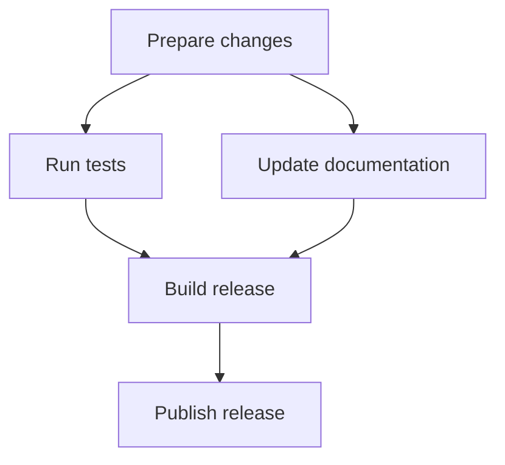

# Formatting examples

Read when checking the source and rendered layout of Markdown structures.

## Paragraph breaks

### Source

```markdown
The cache expires after 60 seconds.

Restart the service to apply the setting.
```

### Rendered

The cache expires after 60 seconds.

Restart the service to apply the setting.

## List continuations

Item 2 continues in the same paragraph.
Item 3 has a separate paragraph within the same list item.

### Source

```markdown
1. Open the document
2. Review the draft
   Check the examples in the same pass
3. Run the checks

   Save the results with the draft
4. Publish the update
```

### Rendered

1. Open the document
2. Review the draft
   Check the examples in the same pass
3. Run the checks

   Save the results with the draft
4. Publish the update

## GitHub Alert

### Source

```markdown
> [!IMPORTANT]
>
> Use the same input and concurrency.
>
> Measure again if either changes.
```

### Rendered

> [!IMPORTANT]
>
> Use the same input and concurrency.
>
> Measure again if either changes.

## Dependency graph

In this graph, an arrow points from a prerequisite to the task that requires it.



Tests and documentation can run in parallel after the changes are ready.
The release build requires both results.

## LaTeX notation

These examples use `$...$` for inline math and `$$...$$` for display math.

| Relationship | Expression | Define |
| --- | --- | --- |
| Equality | $a=b$ | Quantities and conditions |
| Approximation | $a\approx b$ | Tolerance or basis |
| Comparison | $a<b$ | Units and comparison conditions |
| Inclusion | $A\subseteq B$ | Membership of each set |
| Implication | $P\Rightarrow Q$ | Assumptions under which it holds |
| Priority | $A\succ B$ | Meaning of the ordering |
