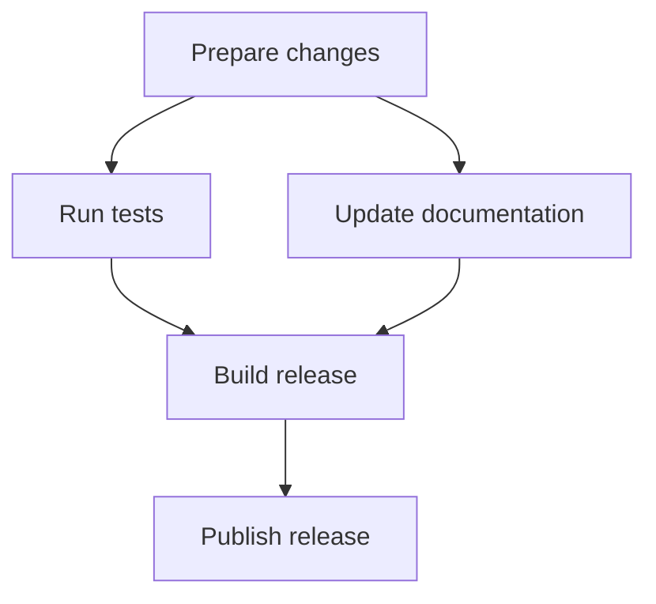

# Formatting details and examples

For GitHub Alerts, put an empty quoted line containing only `>` immediately after the marker.
Put another empty quoted line between body paragraphs.

| Alert | Use |
| --- | --- |
| NOTE | Supporting information |
| TIP | Practical advice |
| IMPORTANT | Essential condition |
| WARNING | Immediate problem |
| CAUTION | Risk or potential loss |

Place Alerts at the top level near the content they qualify and use them selectively.

Use fenced `mermaid` blocks for graphs and diagrams.
Choose a diagram type that matches dependencies, sequence, state transitions, or data flow.
Express dependencies as a dependency graph, with arrows from a prerequisite to the task that requires it.
State what arrows mean in other diagram types.
For numerical charts, preserve values, axes, and units.
When several prerequisite arrows converge, explain whether all are required or whether they are alternatives.

Keep each graph focused on one relationship.
Use short labels, at most five nodes horizontally, and a vertical layout or separate diagrams when needed.
Quote labels containing Korean text, punctuation, or parentheses.
Keep detailed conditions and the main interpretation outside the diagram.
Provide `accTitle` and `accDescr` where supported.
Use weights, priorities, or cycles only when the underlying relationship supports them.

Use LaTeX for relationships expressed as equations or symbols outside graphs.
Define variables, units, assumptions, and symbol meanings near the expression.
Match equality, approximation, inclusion, and implication to the strength of the claim.
Use `\text{...}` for Korean text inside math.
Choose math delimiters supported by the destination and keep long explanations outside equations.
Use a code block for source syntax and the destination's math syntax for a rendered equation.

## Examples

### Paragraph breaks

#### Source

```markdown
The cache expires after 60 seconds.

Restart the service to apply the setting.
```

#### Rendered

The cache expires after 60 seconds.

Restart the service to apply the setting.

### List continuations

Item 2 continues in the same paragraph.
Item 3 has a separate paragraph within the same list item.

#### Source

```markdown
1. Open the document
2. Review the draft
   Check the examples in the same pass
3. Run the checks

   Save the results with the draft
4. Publish the update
```

#### Rendered

1. Open the document
2. Review the draft
   Check the examples in the same pass
3. Run the checks

   Save the results with the draft
4. Publish the update

### GitHub Alert

#### Source

```markdown
> [!IMPORTANT]
>
> Use the same input and concurrency.
>
> Measure again if either changes.
```

#### Rendered

> [!IMPORTANT]
>
> Use the same input and concurrency.
>
> Measure again if either changes.

### Dependency graph

In this graph, an arrow points from a prerequisite to the task that requires it.



Tests and documentation can run in parallel after the changes are ready.
The release build requires both results.

### LaTeX notation

These examples use `$...$` for inline math and `$$...$$` for display math.

| Relationship | Expression | Define |
| --- | --- | --- |
| Equality | $a=b$ | Quantities and conditions |
| Approximation | $a\approx b$ | Tolerance or basis |
| Comparison | $a<b$ | Units and comparison conditions |
| Inclusion | $A\subseteq B$ | Membership of each set |
| Implication | $P\Rightarrow Q$ | Assumptions under which it holds |
| Priority | $A\succ B$ | Meaning of the ordering |
