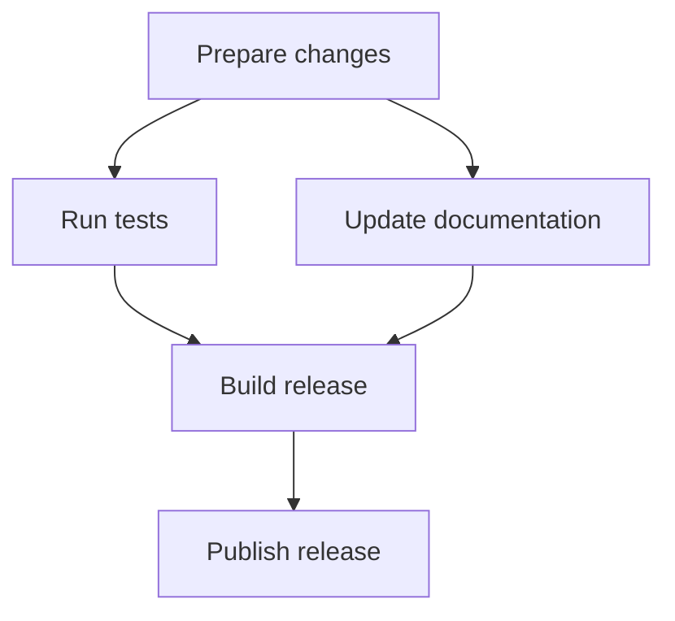

# Formatting Examples

Use these examples to check source structure and the intended rendered result.

## Paragraph breaks

Use a blank line between intended paragraphs.

```markdown
The first paragraph reports the result.

The second paragraph gives the next action.
```

The first paragraph reports the result.

The second paragraph gives the next action.

A single source newline can join two sentences within one paragraph.
Use one sentence per source line in authored Markdown while preserving intentional paragraph breaks.

## GitHub Alert

Put an empty quoted line after the Alert marker and between body paragraphs.

```markdown
> [!IMPORTANT]
>
> Use the same input and concurrency.
>
> Measure again if either changes.
```

> [!IMPORTANT]
>
> Use the same input and concurrency.
>
> Measure again if either changes.

| Marker | Purpose |
| --- | --- |
| `[!NOTE]` | Supporting information |
| `[!TIP]` | An easier way to complete the task |
| `[!IMPORTANT]` | A condition essential to the goal |
| `[!WARNING]` | A problem requiring immediate attention |
| `[!CAUTION]` | Risk or potential loss from an action |

## Dependency graph

Use a `mermaid` fence.
In this graph, an arrow points from a prerequisite to the task that requires it.



Tests and documentation can run in parallel after the changes are ready.
The release build requires both results.

Choose another Mermaid diagram type when the relationship is a sequence, state transition, or data flow.
State what the arrows mean for that diagram.
For numerical charts, preserve the values, axes, and units.

## LaTeX notation

These examples use `$...$` for inline math and `$$...$$` for display math.
Use the delimiters supported by the destination.

| Relationship | Expression | Define |
| --- | --- | --- |
| Equality | $a=b$ | Quantities and conditions |
| Approximation | $a\approx b$ | Tolerance or basis |
| Comparison | $a<b$ | Units and comparison conditions |
| Inclusion | $A\subseteq B$ | Membership of each set |
| Implication | $P\Rightarrow Q$ | Assumptions under which it holds |
| Priority | $A\succ B$ | Meaning of the ordering |

Use a code block when showing the source syntax.
Use the destination's math syntax when showing the rendered equation.
